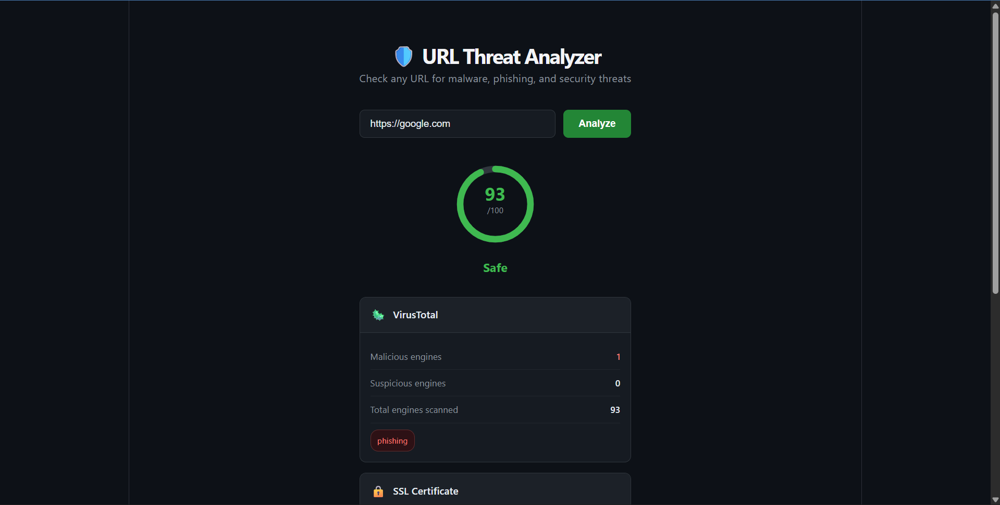
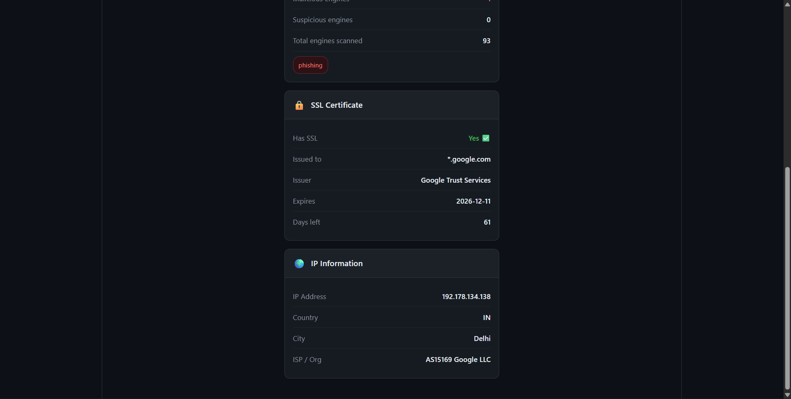

# 🛡️ URL Threat Analyzer

A real-time URL security analysis tool that checks any URL for malware, phishing, and security threats using multiple intelligence sources.




## 🌐 Live Demo
https://url-threat-analyzer-frontend.onrender.com

## 🔍 What It Does

Enter any URL and get an instant security report:

- **Trust Score (0–100)** — weighted risk score combining all signals
- **VirusTotal Scan** — checks against 90+ antivirus engines simultaneously
- **SSL Certificate** — validates HTTPS, issuer, expiry, and days remaining
- **IP Intelligence** — geolocation, ISP, and network info via IPinfo

## 🏗️ Architecture

```
Browser
   │
   ▼
nginx (port 80)
   ├── /          → React frontend (static files)
   └── /api/      → FastAPI backend (Python)
                        ├── VirusTotal API v3
                        ├── SSL socket check
                        └── IPinfo API
```

All services run in Docker containers on the same network. The frontend never talks to external APIs directly — all requests go through the backend, keeping API keys server-side.

## 🧰 Tech Stack

| Layer | Technology |
|-------|-----------|
| Frontend | React 18 + Vite |
| Backend | FastAPI (Python 3.12) |
| Server | Uvicorn (ASGI) |
| Reverse Proxy | nginx |
| Containerization | Docker + Docker Compose |
| Threat Intel | VirusTotal API v3 |
| IP Data | IPinfo API |

## 🚀 Quick Start

### Prerequisites
- [Docker Desktop](https://www.docker.com/products/docker-desktop/)
- VirusTotal API key (free at [virustotal.com](https://www.virustotal.com/gui/my-apikey))
- IPinfo API key (free at [ipinfo.io](https://ipinfo.io/account/home))

### Run with Docker

```bash
git clone https://github.com/YOUR_USERNAME/url-threat-analyzer.git
cd url-threat-analyzer

# Add your API keys
cp backend/.env.example backend/.env
# Edit backend/.env with your keys

# Start everything
docker compose up --build
```

Open **http://localhost** in your browser.

### Run without Docker (development)

```bash
# Backend
cd backend
python -m venv venv
venv\Scripts\activate      # Windows
pip install -r requirements.txt
uvicorn main:app --reload --port 8000

# Frontend (new terminal)
cd frontend
npm install
npm run dev
```

Open **http://localhost:5173**

## 📁 Project Structure

```
threat-analyzer/
├── backend/
│   ├── main.py                 # FastAPI app + CORS config
│   ├── requirements.txt
│   ├── Dockerfile
│   ├── .env.example            # API key template (never commit .env)
│   ├── models/
│   │   └── schemas.py          # Pydantic request/response models
│   ├── routers/
│   │   └── analyze.py          # POST /api/analyze endpoint
│   └── services/
│       ├── virustotal.py       # VirusTotal API v3 integration
│       ├── ssl_checker.py      # SSL certificate inspection
│       ├── ip_info.py          # IP geolocation
│       └── scorer.py           # Risk scoring engine
├── frontend/
│   ├── src/
│   │   ├── App.jsx             # Main component + state management
│   │   ├── api.js              # fetch() wrapper for backend calls
│   │   └── components/
│   │       ├── URLInput.jsx    # Search form
│   │       ├── ScoreMeter.jsx  # SVG circular score display
│   │       └── ResultCard.jsx  # Info card component
│   ├── Dockerfile              # Multi-stage: Node build → nginx serve
│   └── nginx.conf              # Reverse proxy config
└── docker-compose.yml          # Orchestrates backend + frontend
```

## 🔐 Security Design Decisions

**API keys stay server-side** — The React frontend calls `/api/analyze` on the same host. nginx proxies this to the FastAPI backend, which holds the API keys. Keys never reach the browser.

**Async parallel requests** — VirusTotal and IPinfo are fetched simultaneously with `asyncio.gather()`, cutting response time roughly in half.

**Graceful degradation** — If any API is unavailable (key missing, rate limit, timeout), that card shows "Not available" instead of crashing the whole response.

**Trust score formula:**
- Start at 0 risk
- VirusTotal: up to 60 penalty points (weighted by malicious ratio)
- Suspicious flags: up to 10 penalty points
- No SSL: +20 penalty points
- Invalid/expired cert: +30 penalty points
- Final trust score = 100 − risk

## 📄 License

MIT
